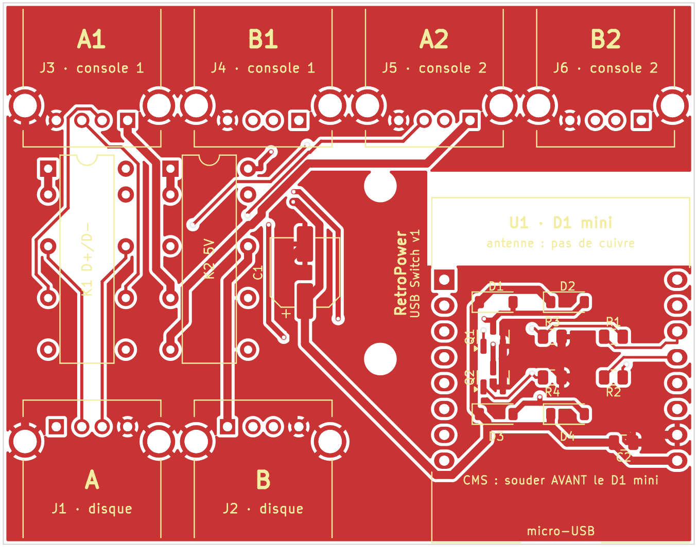
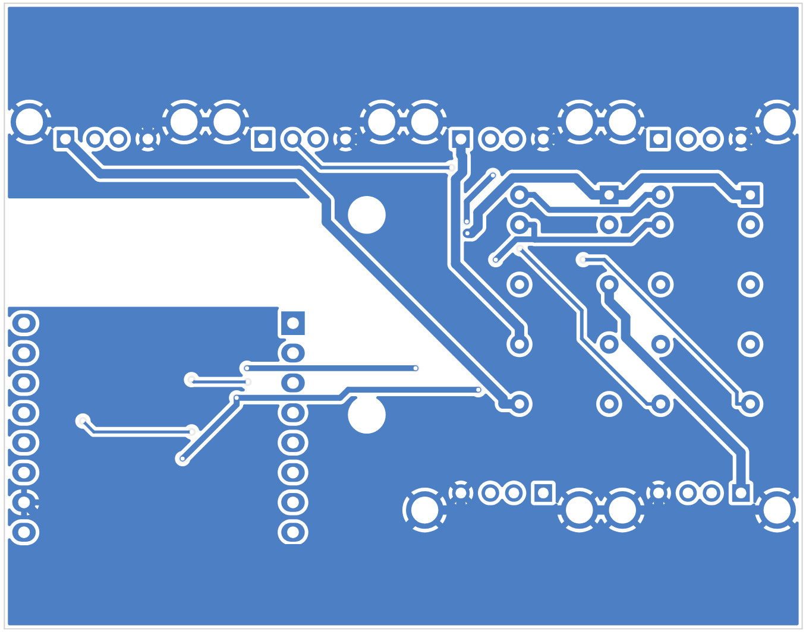
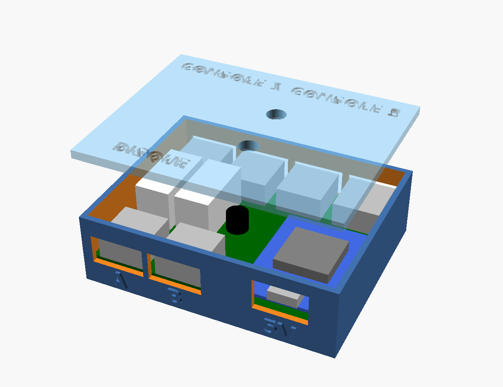
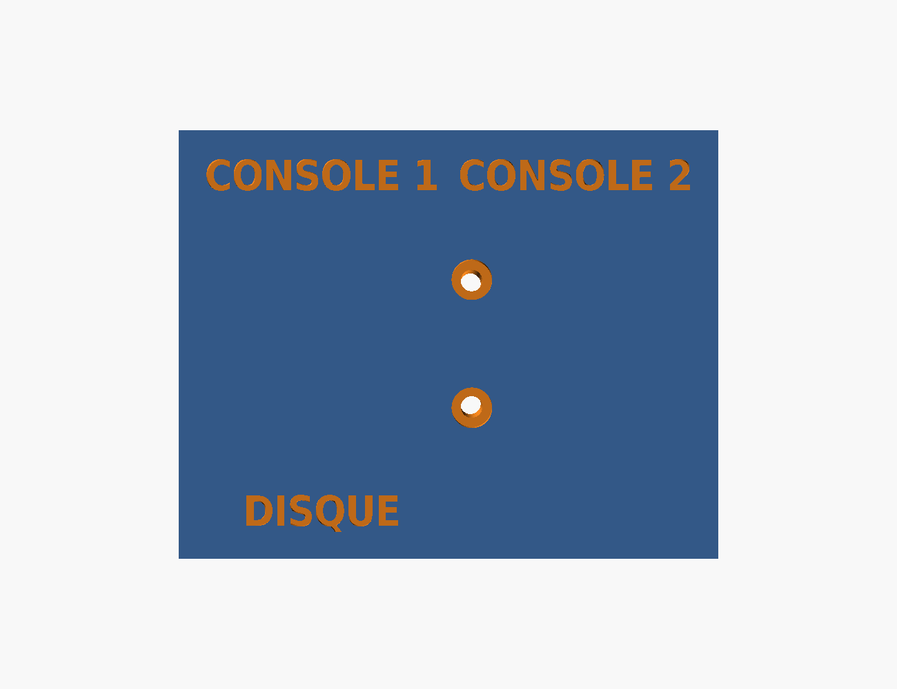

# Wi-Fi USB disk switch

Side project, same idea as RetroPower: one 2.5" USB disk shared between two
consoles, switched over Wi-Fi.

Status: **built and working**, sharing one partitioned disk between a
**Wii U** (console 1) and a **Wii** (console 2). The disk follows the Wii
on its own: it goes to the Wii when the Wii turns on, and back to the Wii U
when it turns off.

Why: the Wii crashed when it was switched back on from standby with a USB
disk plugged in (green LED, then everything off, until the mains was
unplugged). Taking the disk away from the Wii whenever it is off removes
the problem, and sharing the disk between two consoles comes for free.

## What it does

A 2.5" disk with a Y cable has two plugs:

- **A**: 5 V + data (D+ / D-) + ground — the main plug;
- **B**: 5 V + ground only — extra current for the disk.

The board has six USB-A sockets: **A** and **B** for the disk, **A1 / B1**
toward console 1, **A2 / B2** toward console 2. Two bistable relays move
the four lines that matter together:

| Relay | Pole 1 | Pole 2 |
|---|---|---|
| K1 | D- | D+ |
| K2 | 5 V of A | 5 V of B |

Common contact on the disk side, NC (relay RESET) toward console 1,
NO (relay SET) toward console 2. Ground stays common to all six sockets.

A change-over contact opens one side before it closes the other, so the two
consoles' 5 V can never be connected together, and the console that is not
selected is completely cut off from the disk.

Same relay, same pinout and same coil driver as RetroPower: one AO3400A per
coil set, 100 Ω gate resistor, 10 kΩ pull-down, a 1N4148WS across each
coil. Both relays move together: Q1 fires both SET coils, Q2 both RESET
coils. The coils run from the D1 mini's 5 V (about 220 mA for two coils,
too much for its 3.3 V regulator); the HFD2/003 coil accepts up to 6 V.

The D1 mini is powered by its own micro-USB, from any 5 V charger. That
5 V never touches the disk's lines: the disk is still powered by the
selected console, exactly as without the switch.

## Board

- 67.8 × 53.2 mm, 2 layers, 1.6 mm thick (the US-306 pins stick out 3.5 mm
  under their body: on a thicker board there is nothing left to solder).
- Gerbers for JLCPCB: [`hardware/gerbers_RetroPower_USB_Switch.zip`](hardware/gerbers_RetroPower_USB_Switch.zip).
- Parts: [`hardware/BOM.csv`](hardware/BOM.csv).
- The board is generated by scripts, KiCad 7 Python (`build_usbswitch.py` →
  placement and nets, `route_usbswitch.py` → FreeRouting 2.0.1 + ground
  pours, `finish_usbswitch.py` → silkscreen + DRC). KiCad DRC: 0 errors.

### Check the USB-A sockets before ordering the PCB

The footprint comes from the seller's drawing of the **US-306** (the
US-307 has the same footprint), which differs from the usual standard
(shell legs 1.45 mm from the pins instead of 2.71 mm). The US-306 sockets
used for the prototype matched it. Generic sockets vary, so if you buy
another model, check with the sockets in hand:

1. distance between the two shell legs, centre to centre: **13.14 mm**;
2. distance between the row of 4 pins and the axis of the legs: **1.45 mm**;
3. spacing of the 4 pins: **2.5 / 2.0 / 2.5 mm** (7.00 mm between the two
   outer ones).

And the one that matters most: **which pin carries 5 V.** Plug a USB
charger into a socket and measure. Socket laid as on the board, opening
toward you, seen from above: **5 V must be the outer pin on the LEFT**
(square pad, pin 1). If it is on the right, the footprint must be mirrored
before ordering — otherwise the consoles' 5 V would end up on the ground
side.

Swapping D+ and D- would not matter: the six sockets are identical and the
data goes straight through.

### Assembly order

1. **The SMD parts under the D1 mini first**: D1–D4, Q1, Q2, R1–R4, C2.
   Once the module is on, they are out of reach. The four diodes are all
   1N4148WS (flyback, one per coil) and go **as printed**: the stripe on the
   **closed side** of the silkscreen rectangle = cathode = 5 V side (no 180°
   trick, unlike RetroPower's D1/D2).
2. C1 (the `+` is marked).
3. The two relays, then the six USB-A sockets.
4. The D1 mini last, flat on its male headers (the enclosure's micro-USB
   opening is sized for that height). Micro-USB on the edge. Only **5V, G,
   D1 and D2** are wired, all on the same row. To make the module easy to
   remove, solder just those four plus **RST** and **3V3** on the other row
   (unconnected pads, they only hold the corners).

Flash the D1 mini over USB **before** soldering it (its USB stays reachable
afterwards anyway, through the enclosure).

## Wiring

- The disk's Y cable: plug **A** into socket **A**, plug **B** into **B**.
- Four **USB-A male to USB-A male** cables, carrying **data** (many cheap
  ones are charge-only and the console will never see the disk):
  **A1 / B1** to console 1 (Wii U), **A2 / B2** to console 2 (Wii).
  **A1 / A2 must go to the port your USB loader reads from.**
- Console 1 is the relays' rest position: put there the console that should
  keep the disk by default.
- A 5 V charger on the D1 mini's micro-USB.

## Firmware

[`usb_switch_wifi.yaml`](usb_switch_wifi.yaml), ESPHome on the D1 mini:

| D1 mini | GPIO | Role |
|---|---|---|
| D2 | GPIO4 | RESET coils → **console 1** |
| D1 | GPIO5 | SET coils → **console 2** |

- In Home Assistant: one select, **"Wii U / Wii"** (names set by
  `console1_name` / `console2_name`), to switch by hand.
- **Automatic mode, in the firmware itself**: when console 2 (the Wii)
  turns on, the disk goes to it; when it turns off, the disk goes back to
  console 1 (the Wii U). No Home Assistant automation needed.
- **The firmware never takes the disk away from a console that is ON**
  (unplugging USB in the middle of a write can corrupt the disk): if the
  Wii U is running and using the disk, switching the Wii on does not steal
  it.
- Both rules need the consoles' RetroPower sensors, read from Home
  Assistant: put their entity IDs in `console1_sensor` / `console2_sensor`,
  and in Home Assistant tick **"Allow the device to perform Home Assistant
  actions"** (Settings → Devices & services → ESPHome → the switch →
  Configure). If Home Assistant is down, the board keeps its position.
- The relays cannot report their position. The firmware stores the last
  choice in flash and, at boot, sends one pulse to that same position: the
  relays are already there, nothing moves, but firmware and relays agree.

## Enclosure

Two parts to print, generated from the board file so the openings fall on
the connectors: [`enclosure/usb_switch_base.stl`](enclosure/usb_switch_base.stl)
and [`enclosure/usb_switch_lid.stl`](enclosure/usb_switch_lid.stl)
(source: `enclosure/usb_switch_enclosure.scad`, OpenSCAD).

- 71.5 × 56.9 × 23.0 mm outside (port labels raised 0.8 mm on the walls).
- Resin (SLA) or FDM. In FDM: PLA or PETG, 0.2 mm layers, no supports; the
  base prints upright, the lid is already exported upside down.
- The board sits on two standoffs and seven small posts under the sockets,
  so plugging a cable presses on plastic, not on the solder joints.
- **2 × M2.5 × 20 mm screws + 2 M2.5 nuts**: each screw goes through the
  lid, a pillar that holds the board down, the board, and into a nut trapped
  under the base.
- Port names **raised on the walls** under each opening (A1 B1 A2 B2 at the
  back, A B 5V at the front), CONSOLE 1 / CONSOLE 2 / DISQUE **engraved
  1 mm deep** on the lid.
- Checked against JLCPCB's SLA resin rules: every wall and every text
  stroke is at least 0.8 mm (walls 1.6 mm, lid 2.4 mm, lip 1.5 mm).
- The cavity is 13 mm tall above the board: the relays are 10.6 mm on the
  datasheet (±0.4 mm), counted as 12 mm after measuring, plus 1 mm. Other
  relays: change `INNER_H` in the generator and re-export.
- The micro-USB opening assumes the connector is centred on the D1 mini, as
  on the WEMOS original. Check your clone.

## Known limits

- **USB 2.0 high speed through a general-purpose relay.** The HFD2 datasheet
  gives no high-frequency figures. It works in practice (games load from the
  disk on both consoles), like the mechanical USB 2.0 sharing switches that
  do the same thing, and the data path is short. If you rely on it for big
  copies, check a large file once.
- Both consoles' grounds are joined through the board. They usually are
  already, through the TV.
